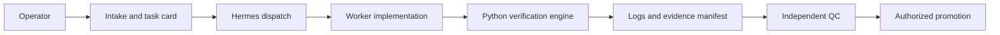

# Software Factory

A Hermes-first software delivery workflow with a standalone Python verification
engine. Turn a bounded task into an implementation, test evidence, and a reviewable
candidate. Hermes coordinates the work; the engine checks execution and evidence.

This is an early release extracted from a working local installation. It is not
a hosted service, a general-purpose agent runtime, or a sandbox for hostile code.

## Choose your entry point

- **Use Hermes:** follow [the Hermes integration guide](docs/hermes.md) to install
  the curated skills and configure your own board and worker profiles.
- **Use another agent or a shell:** follow [the standalone quickstart](docs/quickstart.md).
  The engine does not import Hermes or require a running Hermes gateway.
- **Contribute:** see [CONTRIBUTING.md](CONTRIBUTING.md).

## What it does

1. Intake captures the outcome, scope, non-goals, and executable acceptance criteria.
2. The orchestrator dispatches a bounded card to an isolated working directory.
3. The worker implements and tests the change.
4. The engine validates Compose inputs and runs dependency, coverage, and data-model gates.
5. The runner executes a uniquely named Compose project, collects logs, attempts
   teardown in `finally`, and compares container snapshots.
6. QC checks the actual artifacts and exact revision before promotion.



## Installation

Requires Python 3.11 or later and Git. Docker with Compose v2 is required only
for Compose execution. Dependency auditing additionally needs pip-audit or npm.

Install [uv](https://docs.astral.sh/uv/getting-started/installation/) first.
The checkout defaults to Python 3.12 through `.python-version`; `uv sync` creates
`.venv` and installs the versions recorded in `uv.lock`, including development
and audit tools. No environment activation is needed.

```sh
git clone https://github.com/theRealMarkCastillo/software-factory.git
cd software-factory
uv sync --locked
uv run --locked python -m pytest -q
uv run --locked factory-run --help
```

Standard pip installation is also supported. It resolves dependency ranges from
`pyproject.toml` rather than using `uv.lock`:

```sh
python3 -m venv .venv
.venv/bin/python -m pip install -e '.[dev,audit]'
.venv/bin/python -m pytest -q
```

The default suite skips two explicitly marked live-host checks. See the
contributing guide before enabling them. The package installs the engine;
skills are installed separately from this checkout.

## Engine and Hermes responsibilities

| Component | Responsibility | Requires Hermes |
| --- | --- | --- |
| `factory.policy` | Static Compose checks and Docker command boundary | No |
| `factory.runner` | Execution, artifacts, cleanup, postflight checks | No |
| `factory.audit` | Dependency vulnerability checks | No |
| `factory.coverage` | Coverage of added Python lines, including dirty worktrees | No |
| `factory.datamodel` | Data-model declarations and referenced test checks | No |
| `factory.evidence` | Evidence manifest creation and acceptance checks | No |
| `factory.verify` | Read-only verification of evidence against a candidate/base revision | No |
| Curated skills | Intake, dispatch, worker behavior, QC | Hermes integration |
| Board and profiles | Scheduling, worker permissions, lifecycle transitions | Hermes installation |

The engine retains installation-specific defaults: the artifact directory is
under `~/.hermes`, the runner coverage base is `main`, and policy defaults include
example protected projects and reserved ports. Add your host protection through
an explicit `FACTORY_HOST_CONFIG` file; see [deployment guidance](docs/deployment.md). See [architecture and limitations](docs/architecture.md).

## Safety and evidence

Compose validation rejects privileged containers, dangerous mounts, external
resources, host ports, and other unsafe declarations. Each file is checked before
merging, so overrides cannot conceal unsafe input. Security-sensitive paths must
not contain unresolved interpolation. Bind sources under a home directory are
rejected in absolute form. A repository-relative source is allowed only when the
subject checkout is itself nested below a user home directory
(`/Users/<user>/...` or `/home/<user>/...`) and the source is an existing
ordinary subtree: it may not resolve to the repository root, name or contain a
credential/metadata subtree (`.env*`, `.git`, `.ssh`, ...), or contain a symlink
that points at the repository root, outside the repository, or into a sensitive
subtree. Unreadable trees fail closed. The runner rejects a `repo_path` that is
the host root, a sensitive host root, or a home directory before Compose
validation. Static validation inspects path metadata only and cannot prevent a
concurrent filesystem mutation between validation and container start.

Coverage runs repository tests **on the host before Compose**. Those tests and
build inputs must be trusted. Agent instructions are not an OS security boundary.
Containers and project names do not establish isolation against malicious host
processes, arbitrary code execution, or every Docker feature.

A zero test exit is only one part of acceptance. The runner also requires valid
evidence and gate outcomes. Disabled gates and unavailable audits can leave useful
diagnostic artifacts, but cannot certify an assembled acceptance pass. Abrupt
process termination can prevent cleanup; postflight comparison is detection, not
rollback or proof that nothing happened during execution.

Acceptance evidence is schema-versioned and bound to a clean source revision, an
immutable diff base and the engine build that produced it. `factory-verify`
re-checks a directory against an explicit candidate and base offline and
read-only, and exits `0` only when it can certify. `factory-promote` is the only
sanctioned way to move a local branch: it verifies in-process, refuses a dirty
worktree, a target checked out anywhere, a moved base or a non-fast-forward
candidate, and advances exactly one ref with a compare-and-swap. It never
pushes, tags or deploys. See the [evidence-gate documentation](docs/evidence-gate.md)
and its stated limits: the digest is integrity, not same-UID attestation, and
raw Git outside the command is not intercepted.

## Documentation

- [Standalone quickstart](docs/quickstart.md)
- [Evidence gate: producer and verifier](docs/evidence-gate.md)
- [Hermes setup and workflow](docs/hermes.md)
- [Architecture and supported boundaries](docs/architecture.md)
- [Skill inventory and provenance](docs/skill-inventory.md)
- [Public release checklist](docs/public-release.md)
- [Security reporting](SECURITY.md)

This initial public snapshot excludes private operational history, local agent
configuration, and checkpoint transcripts. Live Docker and clean-install Hermes
orchestration acceptance remain unverified; see the release checklist.

## License

MIT; see [LICENSE](LICENSE). See dependency and provenance information in [THIRD_PARTY_NOTICES.md](THIRD_PARTY_NOTICES.md).
